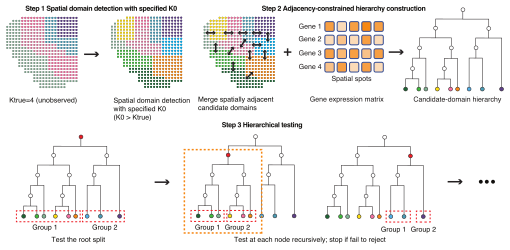

<!-- README.md is generated from README.Rmd. Edit README.Rmd, then knit it. -->

```{r, include = FALSE}
knitr::opts_chunk$set(collapse = TRUE, comment = "#>", fig.path = "man/figures/README-",
                      out.width = "70%", dev = "svg",
                      # vector graphics (SVG); a vector font, because on the HPCC the default "sans"
                      # is a bitmap Helvetica, whose letters svg() stores as small images
                      dev.args = list(family = "Nimbus Sans"))
```


<!-- badges: start -->
<!-- When the repository is public: the R-CMD-check badge from .github/workflows/R-CMD-check.yaml. -->
<!-- badges: end -->

Domain-detection methods divide a tissue into as many domains as they are asked for.
SigDoTS tests which of these domains the data support:

* It starts from more candidate domains than you expect.
* It arranges them in a tree and tests each split against a single-domain model.
* It keeps a split only if it is significant, with error control over the whole tree.



*The three steps of SigDoTS (Figure 1c of the paper).*

## Key features

* **Tests, not thresholds.** Every retained split has passed a test against a single-domain
  null model that includes within-domain spatial correlation and gene-gene covariance; the
  family-wise error rate over all tests is controlled at `alpha` (0.05 by default).
* **Accounts for selection.** The same clustering procedure that produced the candidate
  domains is applied to every simulated dataset, so the "separation that clustering always
  finds" is part of the reference distribution.
* **Works with your objects.** Takes a Seurat object, a SpatialExperiment object, or plain
  matrices; writes the domains back with `add_domains()`.
* **Works with your pipeline.** Start from the built-in k-means, from BANKSY or BayesSpace,
  or from any labels you already have (`candidate_labels`).
* **Readable results.** `print()` draws the tested tree in the console; `summary()` lists
  every test with its statistic, p-value and level; `plot()` draws the domains, the candidate
  domains, the tree and the estimated spatial correlation.
* **Reproducible and parallel.** Same data, arguments and seed give the same result on any
  number of cores.
* **Scales.** A Vecchia approximation (default) keeps memory roughly linear in the number of
  spots; the exact computation is available for smaller samples.

## Installation

SigDoTS needs R 4.3.0 or later. It depends on the CRAN packages GpGp, fields, igraph, Matrix,
RANN and ggplot2, which are installed automatically when SigDoTS is installed from GitHub.

```r
# install.packages("remotes")
remotes::install_github("Yan-Lab-MSU/SigDoTS")
```

Or from a downloaded package file (the dependencies are then not installed automatically):

```r
install.packages(c("GpGp", "fields", "igraph", "RANN", "ggplot2"))
install.packages("path/to/SigDoTS_0.2.5.10.tar.gz", repos = NULL, type = "source")
```

On a new computer, installing the dependencies takes a few minutes; SigDoTS itself installs in
seconds and contains no compiled code. GpGp does, but on Windows and macOS CRAN provides a
ready-made binary of it, so no compiler is needed.

On Linux, igraph needs the GLPK library of the operating system. If `library(SigDoTS)` stops
with "libglpk.so.40: cannot open shared object file", install the system libraries igraph uses
and then igraph again, for example on Ubuntu or Debian:

```bash
sudo apt-get install libglpk-dev libgmp-dev libxml2-dev
```

(on Fedora: `sudo dnf install glpk-devel gmp-devel libxml2-devel`).

Tested on Windows, macOS and Linux: `R CMD check --as-cran` passes on Windows (R 4.6.2),
macOS (R 4.6.2, Apple silicon) and Ubuntu (R 4.5.3, R 4.6.2 and the development version of R)
on GitHub Actions, and in clean Ubuntu 24.04 containers with R 4.6.1; the package also runs
with R 4.3.2, R 4.4.2 and R 4.5.1 on Linux.

Optional, only to make the candidate domains with BANKSY or BayesSpace:

```r
install.packages("BiocManager")
BiocManager::install(c("Banksy", "SingleCellExperiment", "SummarizedExperiment"))   # or "BayesSpace"
```

## Quick start

The package includes a small simulated dataset: 900 spots on a 30 x 30 grid, 200 genes, three
true domains of 300 spots each.

```{r demo}
library(SigDoTS)
dim(sigdots_example$x)          # spots x genes
fit <- sigdots(sigdots_example$x, sigdots_example$coords, K0 = 5)
fit
```

The three domains match the three true regions:

```{r truth}
table(domain = domains(fit)$domain, true_region = sigdots_example$region)
```

```{r domains-plot, fig.width = 5.5, fig.height = 5}
plot(fit)
```

```{r tree-plot, fig.width = 8, fig.height = 4.5, out.width = "90%"}
plot(fit, type = "tree")
```

`summary(fit)` adds a table of the tests (statistic, number of simulated datasets, p-value,
level, decision). The
[Getting started](https://yan-lab-msu.github.io/SigDoTS/articles/SigDoTS.html) tutorial
explains every line of this output.

## Input data format

`sigdots()` takes the data in the form you have it:

| You have | Call |
|---|---|
| a **Seurat** object (normalised, with variable genes set) | `sigdots(obj, K0 = 10)` |
| a **SpatialExperiment** object (with a `logcounts` assay) | `sigdots(spe, K0 = 10, genes = hvg)` |
| a raw **counts matrix** (genes x spots) and a coordinate table | `sigdots(sigdots_prepare(counts), xy, K0 = 10)` |
| a normalised **expression matrix** (spots x genes) and coordinates | `sigdots(x, xy, K0 = 10)` |

plus one number, `K0`, the number of candidate domains (more than the number of domains you
expect). Instead of `K0` you can give your own over-segmentation with `candidate_labels`, a
vector or the name of a metadata column. `add_domains(obj, fit)` writes the domains back into
a Seurat or SpatialExperiment object. See
[Using SigDoTS on your own data](https://yan-lab-msu.github.io/SigDoTS/articles/own-data.html).

## Tutorials

* [Getting started](https://yan-lab-msu.github.io/SigDoTS/articles/SigDoTS.html): the demo
  above, line by line.
* [Real data application](https://yan-lab-msu.github.io/SigDoTS/articles/dlpfc.html): a public
  Visium section of human brain cortex with manually labelled layers, from download to the
  domains, and one layer analysed on its own.
* [Using SigDoTS on your own data](https://yan-lab-msu.github.io/SigDoTS/articles/own-data.html):
  the five input forms (Seurat, SpatialExperiment, Scanpy file, counts, matrices), the choice of
  the candidate domains, exact or approximate spatial computation, run time and memory.
* [Troubleshooting and FAQ](https://yan-lab-msu.github.io/SigDoTS/articles/faq.html): every
  error and warning the package can give, and what to do.
* [How SigDoTS works](https://yan-lab-msu.github.io/SigDoTS/articles/how-it-works.html): the
  method step by step, without formulas.

All but the real-data application are also installed with the package: `vignette("SigDoTS")`,
`vignette("own-data")`, `vignette("faq")`, `vignette("how-it-works")`.

## How long does it take?

Measured in the paper's scalability experiment (simulated data with 2,000 genes and three
domains, `K0 = 5`, exact spatial computation, 10 cores; mean of 2 datasets per size; peak
memory of the whole run including the 10 worker processes):

| Spots | Run time | Peak memory |
|---:|---:|---:|
| 400 | 14 s | 2.7 GiB |
| 900 | 32 s | 3.5 GiB |
| 1,600 | 2.0 min | 5.3 GiB |
| 2,500 | 4.3 min | 6.1 GiB |
| 5,041 | 9.2 min | 9.6 GiB |
| 10,000 | 18 min | 19.8 GiB |

With the default Vecchia approximation, 2,500 spots took a median of 4.0 minutes on
three-domain data and 1.4 minutes on one-domain data (10 cores, 680 datasets). Beyond about
20,000 spots use the Vecchia approximation: the exact computation at 50,176 spots took 12
hours and 206 GiB.

## How SigDoTS works, in brief

1. **Candidate domains.** k-means on the first 15 principal components (or BayesSpace, BANKSY,
   or your own labels) divides the spots into `K0` candidate domains.
2. **Tree.** Groups that touch in space are merged pairwise, the most similar first (Ward's
   criterion on the candidate domains' means in the first 15 principal components), into a binary tree.
3. **Tests from the top.** At each split, the statistic is the within-group sum of squares
   divided by the total sum of squares, over all genes (smaller means a clearer split). A
   single-domain model is fitted to the spots of that part of the tree: a matrix-normal
   model whose spatial correlation (strength `eta`, range `ell`, Matérn 3/2) is estimated
   from pairs of spots within the same candidate domain, and whose gene covariance is
   estimated after removing each candidate domain's mean. Datasets simulated from it are
   clustered in the same way, and the p-value is (1 + the number of them that split at
   least as clearly as the data) / (1 + the number of simulated datasets); a normal
   approximation that needs fewer simulated datasets is available
   (`pvalue_method = "normal_adaptive"`). A test on m of the n spots uses the level
   `alpha * (m - 1) / (n - 1)`.
4. **Domains.** A part is split only when its test is significant; otherwise it is a domain.

## Citation

Manuscript in preparation. Until it is published, please cite the package:
`citation("SigDoTS")`.

## Licence and contact

SigDoTS is released under the MIT licence ([LICENSE.md](LICENSE.md)). Questions and bug
reports: open an issue on GitHub, or write to the maintainer (`maintainer("SigDoTS")`).
