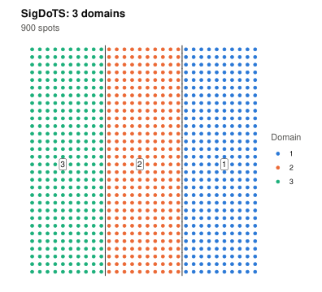
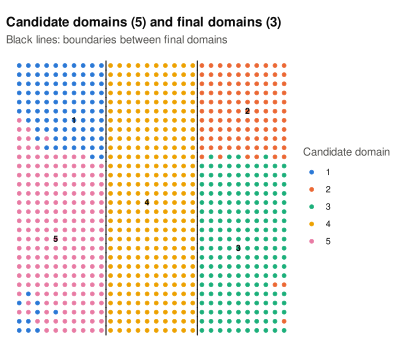
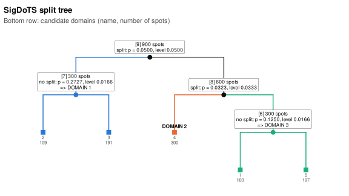
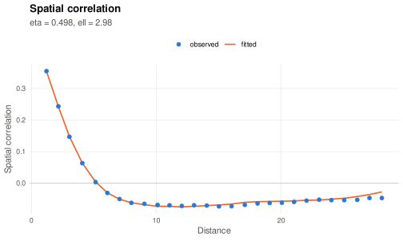

# Getting started with SigDoTS

This tutorial runs SigDoTS on the simulated dataset that comes with the
package and shows how to read every part of the result. It takes about
half a minute to run.

``` r

library(SigDoTS)
```

## The example data

`sigdots_example` has 900 spots on a 30 x 30 grid and 200 genes. The
spots belong to three true domains of 300 spots each. Forty of the genes
(“marker” genes) have different means in the three domains; the noise is
correlated between nearby spots and between genes.

``` r

str(sigdots_example, max.level = 1)
#> List of 3
#>  $ x     : num [1:900, 1:200] 4.92 4.93 4.02 3.07 4.05 ...
#>   ..- attr(*, "dimnames")=List of 2
#>  $ coords: num [1:900, 1:2] 0 0.0345 0.069 0.1034 0.1379 ...
#>   ..- attr(*, "dimnames")=List of 2
#>  $ region: int [1:900] 1 1 1 1 1 1 1 1 1 1 ...
sigdots_example$x[1:3, c(1:3, 198:200)]
#>         marker001 marker002 marker003  gene198  gene199  gene200
#> spot001  4.915282  2.735289  3.102794 3.921413 4.566967 4.581417
#> spot002  4.926125  2.894889  4.703922 4.998155 3.540437 4.564075
#> spot003  4.016329  3.861754  3.960442 5.509391 2.446467 4.972528
table(sigdots_example$region)
#> 
#>   1   2   3 
#> 300 300 300
```

SigDoTS needs two things: the expression matrix `x` (one row per spot,
one column per gene, already normalised) and the coordinates `coords`
(one row per spot, two columns, in the same order). The true regions are
not used; we keep them to compare with the result.

If your data are in a Seurat or SpatialExperiment object, pass the
object itself instead of the two matrices; see
[`vignette("own-data")`](../articles/own-data.md).

## Running SigDoTS

The one choice to make is the number of candidate domains, `K0`. SigDoTS
first divides the spots into `K0` candidate domains (by default with
k-means on the first 15 principal components). `K0` should be larger
than the number of domains you expect, so that each candidate domain
lies inside one true domain; SigDoTS then decides which candidate
domains to merge. Here we use `K0 = 5` for three true domains.

``` r

fit <- sigdots(sigdots_example$x, sigdots_example$coords, K0 = 5)
#> SigDoTS: 900 spots, 200 genes; 5 candidate domains; testing from the top of the tree
#>   test at node 9 (900 spots, 5 candidate domains): split (19 simulated datasets) [14 s]
#>   test at node 7 (300 spots, 2 candidate domains): no split (10 simulated datasets) [3 s]
#>   test at node 8 (600 spots, 3 candidate domains): split (30 simulated datasets) [10 s]
#>   test at node 6 (300 spots, 2 candidate domains): no split (15 simulated datasets) [3 s]
```

While it runs, SigDoTS prints one line per test: where in the tree the
test is, how many spots and candidate domains that part has, the
decision, the number of simulated datasets it used and the time it took.
`verbose = FALSE` silences these lines.

## The split tree

``` r

fit
#> SigDoTS: 900 spots, 200 genes
#> Number of domains: 3   (spots per domain: 300, 300, 300)
#> 
#> Split tree ([node] spots, candidate domains: decision):
#> [9] 900 spots, candidate domains 1,2,3,4,5: split
#> ├── [7] 300 spots, candidate domains 2,3: no split   => DOMAIN 1
#> │   ├── candidate domain 2  109 spots
#> │   └── candidate domain 3  191 spots
#> └── [8] 600 spots, candidate domains 1,4,5: split
#>     ├── [4] 300 spots, candidate domain 4   => DOMAIN 2
#>     └── [6] 300 spots, candidate domains 1,5: no split   => DOMAIN 3
#>         ├── candidate domain 1  103 spots
#>         └── candidate domain 5  197 spots
#> 
#> Use summary() for the tests.
```

How to read the tree:

- Each line starting with a number in brackets is a part of the tree (a
  *node*), with its number of spots and the candidate domains it
  contains.
- `split` or `no split` is the decision of the test at that node.
  SigDoTS tests from the top: the whole sample first; the two sides of a
  split are tested in turn.
- `=> DOMAIN k` marks a part that was not split further: it is the k-th
  final domain. Inside a domain, only the candidate domains and their
  sizes are listed.
- A single candidate domain (here candidate domain 4, `[4]`) is never
  tested; when its parent is split, it becomes a domain by itself.

## The tests

``` r

summary(fit)
#> SigDoTS 0.2.5.8
#> Data:     900 spots x 200 genes
#> Start:    k-means on 15 principal components; 5 candidate domains
#> Spatial:  Vecchia approximation (60 neighbours)
#> Level:    0.05 for the whole tree
#> P-values: Monte Carlo
#> 
#> Number of domains: 3   (spots per domain: 300, 300, 300)
#> 
#> Split tree:
#> [9] 900 spots, candidate domains 1,2,3,4,5: split
#> ├── [7] 300 spots, candidate domains 2,3: no split   => DOMAIN 1
#> │   ├── candidate domain 2  109 spots
#> │   └── candidate domain 3  191 spots
#> └── [8] 600 spots, candidate domains 1,4,5: split
#>     ├── [4] 300 spots, candidate domain 4   => DOMAIN 2
#>     └── [6] 300 spots, candidate domains 1,5: no split   => DOMAIN 3
#>         ├── candidate domain 1  103 spots
#>         └── candidate domain 5  197 spots
#> 
#> Tests, from the top:
#>  test spots statistic null_used      p  level decision
#>   [9]   900     0.718        19 0.0500 0.0500    split
#>   [7]   300     0.935        10 0.2727 0.0166 no split
#>   [8]   600     0.903        30 0.0323 0.0333    split
#>   [6]   300     0.946        15 0.1250 0.0166 no split
```

The table has one row per test: `statistic` is the split statistic of
the data (between 0 and 1; smaller means a clearer split), `null_used`
the number of simulated single-domain datasets the test used, `p` the
p-value, `level` the significance level of this test, and `decision` the
outcome. A split is made when `p <= level`. The level of a test on m of
the n spots is `alpha * (m - 1) / (n - 1)` (here `alpha = 0.05` and n =
900), which keeps the probability of any false split in the whole tree
at most `alpha`. Every column is explained in
[`?summary.sigdots`](../reference/summary.sigdots.md).

By default each test simulates 10 datasets, raised for a test to the
smallest number with which the p-value can reach the level (19 at the
first test), and stops as soon as the decision cannot change. With so
few datasets a p-value takes only a few values; the decision is what the
test establishes. Finer p-values cost more time (`B_min`, `B_max`).

The table is also returned as a data frame:

``` r

summary(fit)$tests
#>   node spots candidate_domains statistic null_used    p_value      level
#> 1    9   900         1,2,3,4,5 0.7178312        19 0.05000000 0.05000000
#> 2    7   300               2,3 0.9345954        10 0.27272727 0.01662959
#> 3    8   600             1,4,5 0.9027189        30 0.03225806 0.03331479
#> 4    6   300               1,5 0.9464686        15 0.12500000 0.01662959
#>   decision
#> 1    split
#> 2 no split
#> 3    split
#> 4 no split
```

## Getting the domains

``` r

head(domains(fit))
#>      spot domain candidate_domain
#> 1 spot001      3                1
#> 2 spot002      3                1
#> 3 spot003      3                1
#> 4 spot004      3                5
#> 5 spot005      3                5
#> 6 spot006      3                5
table(domain = domains(fit)$domain, true_region = sigdots_example$region)
#>       true_region
#> domain   1   2   3
#>      1   0   0 300
#>      2   0 300   0
#>      3 300   0   0
```

The three domains are the three true regions. `domains(fit)` has one row
per spot in the order of the data, so it can be joined to any other
per-spot information. If the data came from a Seurat or
SpatialExperiment object, `add_domains(object, fit)` writes the domain
of every spot into the object.

## Plots

[`plot()`](https://rdrr.io/r/graphics/plot.default.html) draws four
kinds of plots, all ggplot2 objects that you can modify as usual.

The final domains, with the domain numbers and the boundaries between
domains:

``` r

plot(fit)
```



The candidate domains, with the boundaries of the final domains, showing
which candidate domains were merged:

``` r

plot(fit, type = "candidates")
```



The split tree, with each test’s decision, p-value and level:

``` r

plot(fit, type = "tree")
```



The spatial correlation of the noise, as SigDoTS estimated it at the
first test for the single-domain model: the points are the correlation
between pairs of spots at each distance (in units of the distance
between neighbouring spots), after removing each candidate domain’s mean
and averaged over genes; the line is what the fitted model gives. `eta`
is the share of the noise variance that is spatially correlated and
`ell` how far the correlation reaches; here both are close to the values
the data were simulated with (0.5 and 3). The line following the points
means the model describes the spatial correlation of the data. `test =`
draws the same plot for another test of the tree.

``` r

plot(fit, type = "correlogram")
```



## Reproducibility

The same data, arguments and `seed` (default 1) give the same result,
whatever the number of cores (`n_cores`). SigDoTS does not change the
random-number state of your session.

## When a part of the tree cannot be tested

To estimate `eta` and `ell`, SigDoTS needs enough pairs of spots from
the same candidate domain at several distances: at least 4 distance bins
with at least 200 such pairs each. A part of the tree with very few
spots (on a regular grid, fewer than about 80) does not have them.
SigDoTS then leaves that part untested, still tests the rest of the
tree, warns at the end, marks the part `[!] NOT TESTED` in the tree, and
gives its spots no domain (`NA` in
[`domains()`](../reference/domains.md)). Using fewer candidate domains
(a smaller `K0`) makes the parts larger.

## Next

- [`vignette("own-data", package = "SigDoTS")`](../articles/own-data.md):
  preparing your own data and choosing the options.
- [`vignette("faq", package = "SigDoTS")`](../articles/faq.md): every
  error and warning, and the questions users ask most.
- [`vignette("how-it-works", package = "SigDoTS")`](../articles/how-it-works.md):
  what SigDoTS computes, step by step.
